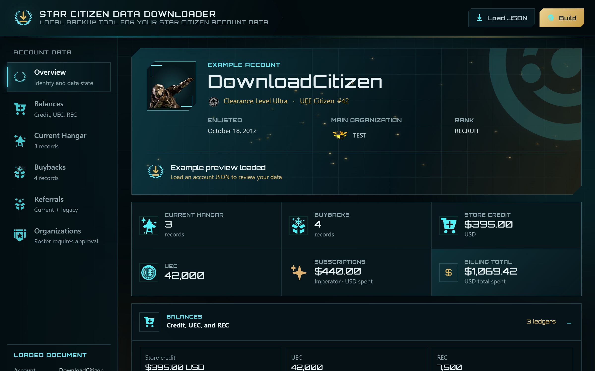
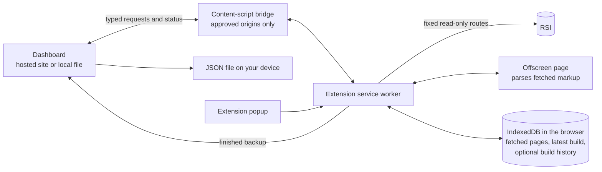

<p align="center">
  
</p>

<h1 align="center">Star Citizen Data Downloader</h1>

<p align="center"><strong>Local backup tool for your Star Citizen account data.</strong></p>

<p align="center"><a href="https://citizendata.download"><strong>Open citizendata.download</strong></a> · <a href="PRIVACY.md">Privacy</a> · <a href="SECURITY.md">Security</a></p>

<p align="center"></p>

Back up your Star Citizen hangar, buybacks, billing, referrals and org members to a file on your device. Free, no sign-up, no upload, no tracking.

- **The dashboard**, a static page under [`docs/`](docs/), opens a backup file, shows it, and exports parts of it. It runs from the hosted site or from a copy on your disk.
- **The browser extension**, under [`extension/`](extension/), reads your account from RSI while you are signed in and hands the result to the dashboard.

There is no server that receives your data. The dashboard and the extension talk only to each other and to RSI. Nothing is uploaded, and there is no analytics, telemetry, or tracking in either part.

> [!NOTE]
> Already use Hangar Link? Open your most recent Hangar Link (hangar.link) JSON with **Load JSON** to see your hangar and buybacks right away. Then choose **Build** to add the more detailed records this tool keeps: the Hangar Log, billing, referrals, organizations, and images.

## How to use it

1. Add the browser extension to Chrome from the [Chrome Web Store](https://chromewebstore.google.com/).
2. Sign in to RSI in the same Chrome profile.
3. Open [citizendata.download](https://citizendata.download) and choose **Build**. The finished backup is saved to your device.

Open a saved backup later with **Load JSON**.

**Without the Chrome Web Store:** download this repository (**Code**, then **Download ZIP**) and unzip it. Open `chrome://extensions`, turn on **Developer mode**, choose **Load unpacked**, and select the `extension` folder. Then follow steps 2 and 3.

**Open source:** the dashboard and the extension are open source under the [MIT License](LICENSE), and all of their code is here, at [github.com/LevyBytes/citizendata.download](https://github.com/LevyBytes/citizendata.download). The hosted site is this repository's [`docs/`](docs/) folder, published by GitHub Pages, and the extension is packaged from its [`extension/`](extension/) folder, so you can read the code that runs in your browser and on your device.

**Use a device only you use:** don't run a build on a public or shared computer. By default the extension keeps your builds, organization rosters and downloaded images in the browser, and the dashboard saves each backup file to your downloads. To keep less, open the extension popup and turn off **Keep earlier builds** under **Build history**; the browser then keeps only your latest build. **Clear all local extension data** in the popup removes everything the extension keeps.

## What a backup holds

One build reads:

| Section | Source on RSI |
| --- | --- |
| Account identity | Your dossier and account settings |
| Hangar Log | Every entry, with RSI's wording kept as written. This is the magic sauce to confirm when things change so updates use a delta rather than reparsing everything from the beginning every run. This reduces the time it takes to update your data and greatly reduces requests to RSI servers. Designed specifically for more responsible handling and time savings. |
| Balances and billing total | Store Credit, UEC, REC, and the total billed amount |
| Ledgers | Store Credit, UEC, and REC histories |
| Orders and subscriptions | Billing order history and subscription history |
| Current Hangar | Each pledge with its contained items, values, insurance, and image addresses |
| Buybacks | Each buyback with its contained items |
| Referrals | Legacy recruits, current prospects, current recruits |
| Organizations | Your public memberships |
| Buy-back prices | Each ordinary buyback's price, any discount as shown, contents, and image addresses, from its buyback page |
| CCU buy-back prices | RSI's store upgrade page: the price RSI asks now for each CCU among the buybacks, and the images of its two ships |

Member rosters of your organizations are a separate build you start from the Organizations panel, for the organizations you tick.

Every finished build is saved to your device automatically as one JSON file. The dashboard checks that a file is valid and unaltered before it shows or exports it.

### Things worth knowing

- A first build of a large account takes a while. Later builds are updates and take less time.
- A buyback's price is the price on the day it was captured, and it is not read again. CCU buyback prices are read again on every build; **Skip** ends that stage and the build still finishes.
- A build can be paused, resumed, or cancelled. If one fails, what it collected opens as a partial backup and **Continue backup** picks up where it stopped.
- If Chrome stops the extension in the middle of a build, the build starts again by itself and goes on without reading again what it already has.

### Records RSI stops listing

RSI can remove a pledge or buyback without writing a Hangar Log entry. When an update finds a record that the previous backup listed and RSI no longer lists:

- If no new Hangar Log entry names it, the record stays in the backup, and the dashboard shows it first, in a red row labelled **POTENTIAL GHOST REMOVAL**.
- If a new log entry names it (a melt, a gift, a buyback, or RSI's own removal notice), the log accounts for it and it leaves the list as usual.

The comparison needs a complete earlier backup; when it cannot run, the backup says why. Removed records are not counted in the Hangar and Buybacks totals.

> [!IMPORTANT]
> Keep your earlier backup files. A removal can only be shown by comparing two backups.

## Reviewing and exporting

The dashboard shows identity, balances, subscriptions, the Hangar and Buybacks (100 to a page, with search and filters across the whole list), CCU history for upgraded pledges, referrals, organizations, and badges. Before you load a file, it shows an example account.

Exports are made only when you ask:

- Selected sections as JSON: account, Hangar, Buybacks, referrals, Hangar Log, billing, organization rosters, or a custom selection.
- A Hangar Link and Fleetview file holding the hangar, the buybacks, or both. Buybacks are written with their captured price.
- An offline image ZIP of the public images a backup links to. It works with the extension off or not installed; with the extension's **Build history** on, the same images are also kept in the extension.

<details>
<summary><strong>Opening a Hangar Link file</strong></summary>

**Load JSON** also opens a Hangar Link file. Such a file holds the hangar and the buybacks and nothing else, so the dashboard opens it as an incomplete build:

- The hangar and the buybacks are shown as the file states them. A record the file holds twice is shown once.
- The Hangar Log, billing, referrals, organizations, badges, and images are empty, and File Status reads "Incomplete build".
- A value the file cannot state is left empty: a pledge valued in UEC (Hangar Link writes a cost of 0 for those) and a buyback with a cost of 0.
- **Build** then reads the whole account from RSI with the extension and replaces what is shown. The file is never handed to the extension.
- A Hangar Link file never leads to a **POTENTIAL GHOST REMOVAL**. That comparison needs a complete earlier build with its Hangar Log.

</details>

## Privacy and permissions

- The extension only reads. It sends account requests only to RSI (`robertsspaceindustries.com`). While a warning is active, it may read RSI's public status feed at `status.robertsspaceindustries.com` for diagnosis. Status feed requests omit credentials and account data.
- Your RSI session token, which keeps you signed in, is read for each request that needs it and sent only to RSI. It is never saved: not in the backup, in messages, in logs, or in the extension's storage.
- The website cannot tell the extension what to read. It can only send a few fixed requests, such as start, pause, resume, or cancel a build, and the extension checks each one itself.
- The extension works only with the hosted dashboard at `https://citizendata.download`, or with a copy on your disk that you approve once in the extension popup.
- No remote code: both parts ship every script they run.

See [PRIVACY.md](PRIVACY.md), [SECURITY.md](SECURITY.md), and the [security model](#security-model) for developers.

<details>
<summary><strong>What the extension keeps in your browser</strong></summary>

- The latest finished build of each account, which the next build updates.
- While a build runs, what it has read so far, so the build survives a restart. It is deleted once the dashboard has saved the backup.
- While **Build history** is on, which it is unless you turn it off: earlier builds, up to the number you choose (5 unless you change it); your organization rosters; and the images the dashboard downloads. Kept builds and rosters can be saved as files or deleted from the popup, and **Delete the kept images** removes the images.

**Clear all local extension data** in the popup removes all of it. The file saved to your device is the lasting record.

**Moving to another browser or a fresh installation.** Open your latest account JSON with **Load JSON** in the dashboard. While **Build history** is on, the dashboard hands it to the extension, so your next build is an update and not a first build. An Orgs JSON or Images ZIP you open afterwards is handed over the same way. **Export recovery backup** and **Import recovery backup** in the popup carry the extension's other records, such as a build that did not finish.

The dashboard keeps the open backup in memory only. Reloading the page discards it; the file is untouched. While **Build history** is on, the dashboard opens your latest build when it loads, in place of the example.

</details>

## For developers

### Architecture



The schemas in [`schema/`](schema/) are the source. `npm run sync:schemas` writes the copies the extension and the dashboard load.

### How it works

- **The backup file:** one JSON document checked against [`schema/account-export.schema.json`](schema/account-export.schema.json) and stamped with a SHA-256 of its content. The dashboard verifies both before it shows or exports a file.
- **Records RSI stops listing:** a record the previous backup listed, which RSI no longer lists and no new Hangar Log entry names, stays in the backup with the state `not-reconcilable`. The comparison runs only against a complete earlier backup whose Hangar Log lines up with the new one; otherwise the backup records that it did not run and why.
- **Hangar Link files:** Load JSON opens, and the export writes, `hangarlink` version 1.
- **The image ZIP:** the dashboard downloads the public images without credentials or referrer, from `robertsspaceindustries.com` and `media.robertsspaceindustries.com` only.
- **A restart mid-build:** if Chrome stops the extension's background worker mid-build, a 30 second watchdog restarts it and the build goes on without repeating a request.
- **The example account:** built into [`docs/scripts/demo-data.js`](docs/scripts/demo-data.js).

### Security model

- The extension's permissions are `alarms`, `cookies`, `offscreen`, `storage`, and `unlimitedStorage`, and its required host permission is `https://robertsspaceindustries.com/*`. The status feed permission `https://status.robertsspaceindustries.com/*` is optional and is used only for diagnosis; status feed requests omit credentials and account data. `unlimitedStorage` gives no access to anything: it stops Chrome from clearing what the extension stores.
- RSI's own account requests need its session token. The extension reads that token from the browser for each request that needs it and sends it only to RSI. It is read transiently, never stored: it is not written to the backup, to messages, to logs, or to the extension's storage.
- The extension only reads. Its requests go to a fixed list of RSI routes held in the extension.
- The dashboard cannot name a URL, method, header, or body. It can only send a small set of typed requests (start a build, pause, resume, cancel, and the like), and the extension checks each plan itself.
- The extension answers the hosted dashboard at `https://citizendata.download` and nothing else, unless you approve a local copy. A copy opened from disk (`docs/index.html` in any folder) must be allowed once in the extension popup, and Chrome's "Allow access to file URLs" must be on for the extension. The approval can be removed in the popup.
- No remote code: both parts ship every script they run, under a content security policy that allows only their own files.

<details>
<summary><strong>Browser storage in detail</strong></summary>

The extension keeps its working data in its own IndexedDB storage in your browser profile:

- The latest finished build of each account: one the extension made, or a complete account file you opened in the dashboard (see "Moving to another browser or a fresh installation" below). Updates and the removal comparison read it.
- While a build runs, each page it fetched, stored once with a checksum, so a build survives a restart. These are deleted when the dashboard confirms the file was saved.
- Earlier builds, while **Build history** is on in the extension popup. It is on unless you turn it off. While it is on, a build that differs from the one before keeps the earlier one, compressed, up to the number you choose (5 unless you change it). Each kept build can be saved as a file or deleted from the popup.
- Your organization rosters as one Orgs JSON, while **Build history** is on. The latest build always carries every roster you collected; with the history on, they are also kept ready as the Orgs JSON file the dashboard saves, replaced whenever a finished build carries different rosters. It is not counted against the number of builds to keep, and can be saved as a file or deleted from the popup.
- The images the dashboard downloads, while **Build history** is on. The dashboard downloads them and builds the Images ZIP as it does without the extension; the extension only stores what the dashboard hands it, one record per image, and makes no image request of its own. On a later visit the dashboard shows them from the extension without the Images ZIP, and the next image download reuses them. Loading an Images ZIP hands its images over in the same way. They are kept until you delete them with **Delete the kept images** in the popup.

**Clear all local extension data** in the popup removes all of it. The extension has Chrome's `unlimitedStorage` permission so that Chrome does not clear this storage when the disk runs low. The file saved to your device is the durable record.

**Moving to another browser or a fresh installation.** Open your latest account JSON with **Load JSON** in the dashboard. While **Build history** is on, the dashboard hands a complete account file to the extension by itself, and the extension keeps it as the account's latest build when it holds no build of that account, or an older one. The next build is then an update and not a first build, and a reload shows your account. The message that confirms the file says what the extension did. The extension checks the file's schema and SHA-256 again before it keeps it. It never replaces a newer build, takes in nothing while a build is in progress, and never takes in a Hangar Link file or a build that did not finish. A build it replaces goes to the build history like any other, and the rosters that build carried are kept in the new one. With Build history off, nothing is handed over.

An **Orgs JSON** you open after the account JSON is handed over in the same way. Its rosters go into the build the extension keeps, for each of the account's organizations whose roster there is missing or older. An **Images ZIP** you open is unpacked by the dashboard, which hands its images to the extension one by one, as described above.

**Export recovery backup** and **Import recovery backup** in the popup carry the extension's other records, such as a run that did not finish. Load JSON also opens a recovery backup: it shows the newest finished build inside the file and hands that build to the extension in the same way.

The dashboard keeps the open backup in memory only. Reloading the page discards it; the file is untouched. While **Build history** is on, the dashboard asks the extension for your latest finished build when it loads and opens it in place of the example. With Build history off it opens the example, and the extension hands it nothing until you build.

</details>

### Repository layout

```text
.github/     the CI workflow
extension/   the Chrome extension, loadable as it is
docs/        the dashboard and the two policy pages, with no build step
schema/      the account and offline-package schemas
scripts/     verification, schema sync, the test runner, packaging, the DCO check
tests/       unit tests, a Node harness that runs the extension against a synthetic RSI, and browser checks
```

No private account export, captured RSI markup, session value, or private fixture belongs in this repository. Tests use a synthetic account.

### Development

Requirements: Node.js 22 or newer and Chrome.

```powershell
npm test
npm run verify
```

On Windows systems that block the `npm.ps1` shim, use `npm.cmd` from PowerShell; do not change the machine execution policy for this project.

`npm test` runs the unit tests, including whole builds of the shipped extension against a synthetic RSI. The browser checks run separately and headless:

<details>
<summary><strong>Browser checks</strong></summary>

| Command | What it checks |
| --- | --- |
| `npm run test:dashboard` | The dashboard in Chrome: layout at many widths, its workflows, and that it makes no remote request. `npm run test:dashboard -- --repairs-only` runs a shorter set. |
| `npm run test:extension` | The unpacked extension in Chrome against a synthetic RSI: approval of a local copy, a full build, an update, build history, pause and cancel, reload, watchdog restart, clearing data. `npm run test:extension -- --large` adds a very large account. |
| `npm run test:readability -- --out <dir>` | Contrast and text spacing. |
| `npm run test:hero-motion -- --out <dir>` | Hero animation. |
| `npm run test:performance`, `test:firefox`, `test:webkit` | Performance, Firefox, and a WebKit engine. A WebKit engine result does not establish Safari or iOS acceptance. Each prints its usage with `--help`. |

</details>

To load the extension from a clone:

1. Open `chrome://extensions` and turn on **Developer mode**.
2. Choose **Load unpacked** and select this repository's `extension` directory.
3. To use a dashboard opened from disk, turn on **Allow access to file URLs** in the extension's details, open [`docs/index.html`](docs/index.html), and allow it in the extension popup.

### Packaging

```powershell
npm run package:extension
```

This verifies the source, then writes a deterministic ZIP with `manifest.json` at its root and its SHA-256 under `dist/`. It does not stage Git, create a release, upload to the Chrome Web Store, publish the website, or change DNS. Those steps are the owner's and are listed in [RELEASING.md](RELEASING.md).

## Contributing

Code contributions are by invitation. Every commit needs a [DCO](https://developercertificate.org/) sign-off (`git commit --signoff`) and a signature GitHub verifies.

Run `npm test` and `npm run verify` before proposing a change, and say plainly if it touches a permission, the schema, privacy, storage, or the release surface.

Do not put private account exports, raw RSI responses, credentials, private screenshots, or private referral or member records in issues, pull requests, or fixtures.

## License

Star Citizen Data Downloader's original software and documentation are licensed under the [MIT License](LICENSE).

Copyright (c) 2026 [LevyBytes](https://github.com/LevyBytes) ([original repository](https://github.com/LevyBytes/citizendata.download)).

The MIT terms require the copyright and permission notice to remain in copies or substantial portions of the software.

As a non-binding community courtesy, forks and derivative projects are requested to acknowledge Star Citizen Data Downloader by LevyBytes and link to the original repository.

Third-party fonts, RSI/CIG visual material, community marks, and owner-supplied example artwork are not relicensed by the MIT License; see [THIRD_PARTY_NOTICES.md](THIRD_PARTY_NOTICES.md).

## Attribution

<p align="center"></p>

<p align="center"><strong>Built for citizens who want local backed up records of their own account history.</strong></p>

<p align="center">This independent community project is not affiliated with or endorsed by Cloud Imperium Games. Account data stays local in the device the browser runs on.</p>

<p align="center">Star Citizen®, Roberts Space Industries® and Cloud Imperium® are registered trademarks of Cloud Imperium Rights LLC. All related intellectual property and marks remain the property of their respective owners.</p>

Font and visual-asset notices are collected in [THIRD_PARTY_NOTICES.md](THIRD_PARTY_NOTICES.md).
