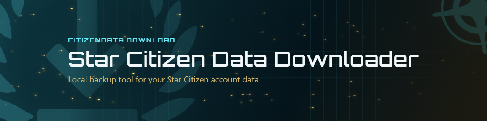
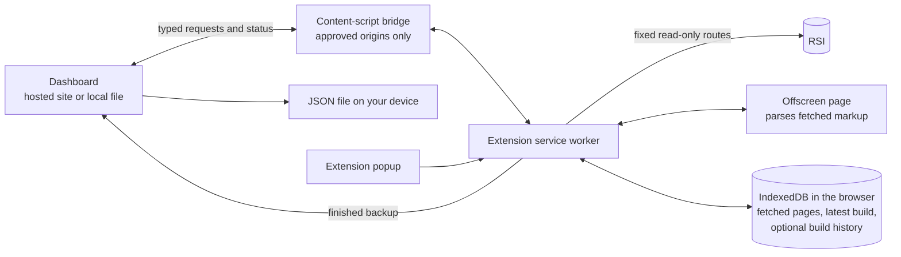

<h1 align="center">Star Citizen Data Downloader</h1>

<p align="center"><strong>Local backup tool for your Star Citizen account data.</strong></p>

<p align="center"><a href="https://citizendata.download"><strong>Open citizendata.download</strong></a> · <a href="PRIVACY.md">Privacy</a> · <a href="SECURITY.md">Security</a></p>

<p align="center"></p>

Back up your Star Citizen hangar, buybacks, billing, referrals and org members to a file on your device. Free, no sign-up, no upload, no tracking.

- **The dashboard**, a static page under [`docs/`](docs/), opens a backup file, shows it, and exports parts of it. It runs from the hosted site or from a copy on your disk.
- **The browser extension**, under [`extension/`](extension/) with its Chrome parts in [`platform/chromium/`](platform/chromium/), reads your account from RSI while you are signed in and hands the result to the dashboard.

There is no server that receives your data. The dashboard and the extension talk only to each other and to RSI. Nothing is uploaded, and there is no analytics, telemetry, or tracking in either part.

> [!NOTE]
> Already use Hangar Link? Open your most recent Hangar Link (hangar.link) JSON with **Load JSON** to see your hangar and buybacks right away. Then choose **Build** to add the more detailed records this tool keeps: the Hangar Log, billing, referrals, organizations, and images.

## HOW TO USE IT

1. Add the browser extension to Chrome from the [Citizen Data Downloader listing in the Chrome Web Store](https://chromewebstore.google.com/detail/citizen-data-downloader/ehklbfcpnadaeodflibpihhgimmmhjpd).
2. Sign in to RSI in the same Chrome profile.
3. Open [citizendata.download](https://citizendata.download) and choose **Build**. The finished backup is saved to your device.

Open a saved backup later with **Load JSON**.

### Several accounts

Each Account JSON of another account you open is added under **Switch Account**, and a newer file of an account already open updates it. Each account keeps its own view, Orgs JSON, and Images ZIP.

| | Without the extension | With the extension |
| --- | --- | --- |
| Accounts you open | Stay until the page is reloaded | A complete verified Account JSON also adds its safe handle and name to the persistent account list, even when **Build history** is off. The full file is retained only while **Build history** is on. |
| **Add new account** | Explains that the website cannot read your RSI sign-in, and offers **Load JSON** | Asks the extension which account is signed in to RSI and adds it by its handle and name. It never starts a build. |

Choose **Build** to back up the account you chose; the extension first checks that RSI is signed in to that account. While a build or an image download runs, accounts cannot be switched or added.

### Installing without the Chrome Web Store

1. Download this repository (**Code**, then **Download ZIP**) and unzip it.
2. With [Node.js](https://nodejs.org/) 22 or newer, run `npm run package:chromium` in the unzipped folder. It writes the extension to `dist/chromium`.
3. Open `chrome://extensions` and turn on **Developer mode**.
4. Choose **Load unpacked** and select the `dist/chromium` folder.
5. Continue with steps 2 and 3 above.

### Open source

The dashboard and the extension are open source under the [MIT License](LICENSE), and all of their code is in this repository, [github.com/LevyBytes/citizendata.download](https://github.com/LevyBytes/citizendata.download), so you can read the code that runs in your browser and on your device.

| Part | Source |
| --- | --- |
| Hosted site | [`docs/`](docs/), published by GitHub Pages |
| Extension | [`extension/`](extension/) |
| Chrome parts | [`platform/chromium/`](platform/chromium/) |
| Manifest | [`manifests/chrome.json`](manifests/chrome.json) |

### Use a device only you use

Don't run a build on a public or shared computer.

By default:

- the extension keeps your builds, organization rosters, and downloaded images in the browser, along with the handle and name of each account you add or load;
- the dashboard saves each backup file to your downloads.

To keep less:

- In the extension popup, turn off **Keep earlier builds** under **Build history**. The browser then keeps no imported full Account JSON, while the safe account summaries remain available to **Switch Account**.
- **Remove this account** under **Switch Account** in the dashboard removes one account, with the builds and Orgs JSON the extension keeps of it. Kept images are shared between accounts, so they stay until you delete them in the popup.
- **Clear all local extension data** in the popup removes everything the extension keeps.

## WHAT EXACTLY IS PARSED ON YOUR BEHALF

A build reads the following sections from your RSI account.

| Section | What it holds |
| --- | --- |
| Account identity | Your dossier and account settings |
| Hangar Log | Every entry, with RSI's wording kept as written |
| Balances and billing total | Store Credit, UEC, REC, and the total billed amount |
| Ledgers | Store Credit, UEC, and REC histories |
| Orders and subscriptions | Billing order history and subscription history |
| Current Hangar | Each pledge with its contained items, values, insurance, and image addresses |
| Buybacks | Each buyback with its contained items |
| Referrals | Legacy recruits, current prospects, and current recruits |
| Organizations | Your public memberships |
| Buy-back prices | Each ordinary buyback's price, any discount as shown, its contents, and image addresses, read from its buyback page |
| CCU buy-back prices | From RSI's store upgrade page: the price RSI currently asks for each CCU among your buybacks, and the images of its two ships |

> [!NOTE]
> **Why the Hangar Log matters**
>
> The Hangar Log shows when something in your account has changed, so an update reads only what changed instead of reading everything again from the beginning.
>
> - Updates take less time.
> - Updates make far fewer requests to RSI's servers.
>
> The tool is designed this way to handle RSI's servers responsibly and to save you time.

**Organization rosters**\
A separate build. Start it from the Organizations panel for the organizations you tick.

**Saving**\
Every finished build is saved to your device automatically as one JSON file.

**Checking**\
Before the dashboard shows or exports a file, it checks that the file is valid and unaltered.

### Build behavior

**First build and updates**\
A first build of a large account takes a while. Later builds are updates and take less time.

**Buyback prices**\
An ordinary buyback's price is the price on the day it was captured, and it is not read again. CCU buyback prices are read again on every build; **Skip** ends that stage, and the build still finishes.

**Pause, resume, and cancel**\
A build can be paused, resumed, or cancelled. If a build fails, what it collected opens as a partial backup, and **Continue backup** picks up where it stopped.

**Restarts**\
If Chrome stops the extension in the middle of a build, the build restarts by itself and does not read again what it already has.

### Can detect ghost removals

RSI can remove a pledge or a buyback without writing a Hangar Log entry. To catch this, an update looks for records that the previous backup listed and RSI no longer lists. What happens to each one depends on whether a new Hangar Log entry names it:

| New Hangar Log entry | Result |
| --- | --- |
| None names the record | The record stays in the backup. The dashboard lists it first, in a red row labelled **POTENTIAL GHOST REMOVAL**. |
| One names it: a melt, a gift, a buyback, or RSI's own removal notice | The log accounts for the record, and it leaves the list as usual. |

The comparison needs a complete earlier backup; when it cannot run, the backup records why. Removed records are not counted in the Hangar and Buybacks totals.

> [!IMPORTANT]
> Keep your earlier backup files. A removal can only be shown by comparing two backups.

## REVIEWING AND EXPORTING

The dashboard shows identity, balances, subscriptions, the Hangar and Buybacks, CCU history for upgraded pledges, referrals, organizations, and badges. The Hangar and Buybacks are listed 100 to a page, with search and filters that cover the whole list. Before you load a file, the dashboard shows an example account.

Exports are made only when you ask for them:

| Export | Contents |
| --- | --- |
| JSON | Selected sections: account, Hangar, Buybacks, referrals, Hangar Log, billing, organization rosters, or a custom selection |
| Hangar Link and Fleetview file | The hangar, the buybacks, or both. Buybacks are written with their captured price. |
| Offline image ZIP | The public images a backup links to |

The image ZIP works with the extension off or not installed. With the extension's **Build history** on, the same images are also kept in the extension. While the download waits before its next request, Build Status says so and counts down, and the log records each wait. **Cancel** stops the download at once, even during a wait, and a cancelled download produces no ZIP.

<details>
<summary><strong>Opening a Hangar Link file</strong></summary>

**Load JSON** also opens a Hangar Link file. Such a file holds only the hangar and the buybacks, so the dashboard opens it as an incomplete build:

- The hangar and the buybacks are shown as the file states them. A record the file holds twice is shown once.
- The Hangar Log, billing, referrals, organizations, badges, and images are empty, and File Status reads "Incomplete build".
- A value the file cannot state is left empty: a pledge valued in UEC (Hangar Link writes a cost of 0 for those) and a buyback with a cost of 0.
- **Build** then reads the whole account from RSI with the extension and replaces what is shown. The file is never handed to the extension.
- A Hangar Link file never leads to a **POTENTIAL GHOST REMOVAL**. That comparison needs a complete earlier build with its Hangar Log.

</details>

## PRIVACY AND PERMISSIONS

**Read only**\
The extension only reads. It sends account requests only to RSI (`robertsspaceindustries.com`). While a warning is active, it may read RSI's public status feed at `status.robertsspaceindustries.com` for diagnosis; those requests omit credentials and account data.

**Your session token**\
The RSI session token that keeps you signed in is read for each request that needs it and sent only to RSI. It is never saved: not in the backup, in messages, in logs, or in the extension's storage.

**The website cannot steer the extension**\
It can send only a few fixed requests, such as start, pause, resume, or cancel a build, and the extension checks each one itself.

**Approved pages only**\
The extension works only with the hosted dashboard at `https://citizendata.download`, or with a copy on your disk that you approve once in the extension popup.

**No remote code**\
Both parts ship every script they run.

See [PRIVACY.md](PRIVACY.md), [SECURITY.md](SECURITY.md), and the [security model](#security-model).

<details>
<summary><strong>What the extension keeps in your browser</strong></summary>

| What | When it is kept | How to remove it |
| --- | --- | --- |
| The latest finished build of each account | Always; the next build updates it | **Remove this account**, or **Clear all local extension data** |
| What a running build has read so far | While the build runs, so it survives a restart | Deleted once the dashboard has saved the backup |
| Earlier builds, up to the number you choose (5 by default) | While **Build history** is on | Save as a file or delete from the popup |
| Your organization rosters | While **Build history** is on | Save as a file or delete from the popup |
| The images the dashboard downloads | While **Build history** is on | **Delete the kept images** |
| The accounts you add with **Add new account** or a complete verified Account JSON: each one's handle and name, and which one you chose last | Whether **Build history** is on or off | **Remove this account**, or **Clear all local extension data** |

**Build history** is on unless you turn it off. **Clear all local extension data** in the popup removes everything in this table. The file saved to your device is the lasting record.

**Moving to another browser or a fresh installation**\
Open your latest account JSON with **Load JSON** in the dashboard. While **Build history** is on, the dashboard hands it to the extension, so a reload shows your account. Your next build reads the whole account again, because the extension builds only on data it read from RSI itself; the builds after it are updates again. An Orgs JSON or Images ZIP you open afterwards is handed over the same way. **Export recovery backup** and **Import recovery backup** in the popup carry the extension's other records, such as a build that did not finish.

**Reloading the page**\
The dashboard keeps open backups in memory only. Reloading the page discards them; the files are untouched. With the extension, a reload lists the accounts you added again and, while **Build history** is on, opens the latest build of each account the extension holds, showing the account you chose last in place of the example.

</details>

## SECURITY

To report a vulnerability, follow [SECURITY.md](SECURITY.md).

### Security model

**Permissions**\
`alarms`, `cookies`, `offscreen`, `storage`, and `unlimitedStorage`. The required host permission is `https://robertsspaceindustries.com/*`. The status feed permission `https://status.robertsspaceindustries.com/*` is optional and is used only for diagnosis; status feed requests omit credentials and account data. `unlimitedStorage` grants no access to anything: it stops Chrome from clearing what the extension stores.

**Session token**\
RSI's account requests need its session token. The extension reads the token from the browser for each request that needs it and sends it only to RSI. The token is read transiently and never stored: it is not written to the backup, to messages, to logs, or to the extension's storage.

**Read only**\
The extension's requests go to a fixed list of RSI routes held in the extension.

**Typed requests only**\
The dashboard cannot name a URL, method, header, or body. It can send only a small set of typed requests (start a build, pause, resume, cancel, and the like), and the extension checks each plan itself.

**Approved origins**\
The extension answers the hosted dashboard at `https://citizendata.download` and nothing else, unless you approve a local copy. A copy opened from disk (`docs/index.html` in any folder) must be allowed once in the extension popup, and Chrome's "Allow access to file URLs" must be on for the extension. The approval can be removed in the popup.

**No remote code**\
Both parts ship every script they run, under a content security policy that allows only their own files.

### Source checks

`npm run verify` fails when it finds any of the following:

- a symbolic link anywhere in the repository;
- a known private demo identifier anywhere in the public source;
- `eval(`, `new Function`, `document.write(`, `innerHTML =`, `outerHTML =`, or `insertAdjacentHTML(` in any JavaScript or HTML file;
- an extension manifest outside the Manifest V3 least-privilege permission contract;
- a dashboard content security policy, or Load and Build controls, outside their contract.

### Dependencies and linters

`package.json` declares no dependencies. Nothing is installed from npm to lint, test, verify, or package this repository.

`npm run lint` runs three linters over the repository, each with its configuration at the repository root. All three run even when one fails, and the run fails when any of them reports a finding.

| Linter | Version | Configuration | What it checks |
| --- | --- | --- | --- |
| [ESLint](https://eslint.org/) | 10.15.0 | [`eslint.config.mjs`](eslint.config.mjs) | JavaScript, with every ESLint recommended rule as an error. An unused disable comment is an error. Each part of the code has a written list of the browser, Chrome, and Node names it may use, and any other name is an error. |
| [Deno lint](https://docs.deno.com/runtime/reference/cli/lint/) | 2.9.8 | [`deno.jsonc`](deno.jsonc) | JavaScript, with Deno's recommended rules. Four rules are switched off, each with its reason in the file. Nothing in this repository runs under Deno. |
| [Biome](https://biomejs.dev/) | 2.6.5 | [`biome.jsonc`](biome.jsonc) | JavaScript, JSON, HTML, and CSS, with Biome's recommended rules. A warning fails the run like an error. Three rules are switched off for the files they do not fit, each with its reason in the file. Biome formats nothing. |

The linters are not packages of this repository. [`scripts/run-linters.mjs`](scripts/run-linters.mjs) finds each one by its environment variable (`ESLINT_BIN`, `DENO_BIN`, `BIOME_BIN`), then under the folder that `DEVROOT` (`$env:DEVROOT` is a variable LevyBytes uses for his Agent Kaizen project, it's not required for contributing to this repository) names, then on the PATH. It prints the Deno version it found and refuses one older than 2.9.8, the version `deno.jsonc` is checked with, which is also later than every fixed version in Deno's published security advisories.

### CI and commit rules

- The GitHub Actions workflow in [`.github/workflows/ci.yml`](.github/workflows/ci.yml) runs `npm test`, `npm run verify`, `npm run check:schemas`, and `npm run package:extension` on every pull request and every push to `main`. Its token is read-only, each action is pinned to a full commit SHA, and the checkout keeps no credentials.
- A repository ruleset, "Require verified signatures on main", is active on the default branch: GitHub refuses any commit there without a signature it verifies.
- Every commit needs a DCO sign-off. The DCO check runs on every pull request and is read from the pull request's base, so a pull request cannot change the check it is held to.
- [Packaging](#packaging) is deterministic: the ZIP's SHA-256 is written beside it, and the folder and the ZIP are checked to hold the same files.
- After the site is published, `npm run check:live-headers` reads each page's `Content-Security-Policy` response header and checks that it holds the page's meta policy and `frame-ancestors 'none'`. It is the only script that contacts the hosted site, and no test runs it.

### Audits

The code is audited with OpenAI Daybreak and Anthropic Mythos, by [LevyBytes](https://github.com/LevyBytes).

## FOR DEVELOPERS

Comments and tests that cite `PARSER_HARDENING.md` and its section numbers refer to the developer's private design record, which is not part of this repository; the code and tests they sit beside are the public account of what each rule does.

### Architecture



The schemas in [`schema/`](schema/) are the source of truth. `npm run sync:schemas` writes the copies that the extension and the dashboard load.

### How it works

**Backup file**\
One JSON document, checked against [`schema/account-export.schema.json`](schema/account-export.schema.json) and stamped with a SHA-256 of its content. The dashboard verifies both before it shows or exports a file.

**Can detect ghost removals**\
A record that the previous backup listed, that RSI no longer lists, and that no new Hangar Log entry names stays in the backup with the state `not-reconcilable`. The comparison runs only against a complete earlier backup whose Hangar Log lines up with the new one; otherwise the backup records that it did not run, and why.

**Hangar Link files**\
**Load JSON** opens, and the export writes, `hangarlink` version 1.

**Image ZIP**\
The dashboard downloads the public images without credentials or referrer, and only from `robertsspaceindustries.com` and `media.robertsspaceindustries.com`. Every wait in the download, between requests or after RSI refuses them, ends at once on **Cancel**. Build Status shows each wait with a countdown, and the log records it.

**Several accounts**\
The dashboard holds one session per account, matched by handle, or by the file's local account ID when the file has no handle. An Orgs JSON or Images ZIP opens only under its own account. A build or roster run started for the account shown names that account, and the extension declines the run, before reading any section, when RSI is signed in to another account. While a job runs, accounts cannot be switched or added, and a file of another account is not opened.

**Restart mid-build**\
If Chrome stops the extension's background worker mid-build, a 30 second watchdog restarts it, and the build continues without repeating a request.

**Example account**\
Built into [`docs/scripts/demo-data.js`](docs/scripts/demo-data.js).

### Browser storage

<details>
<summary><strong>Browser storage in detail</strong></summary>

The extension keeps its working data in its own IndexedDB storage in your browser profile:

**Latest build**\
The latest finished build of each account, either one the extension made or a complete account file you opened in the dashboard (see "Importing files" below). Updates and the removal comparison read it.

**Pages of a running build**\
While a build runs, each page it fetched, stored once with a checksum, so the build survives a restart. These are deleted when the dashboard confirms the file was saved.

**Build history**\
Earlier builds, while **Build history** is on in the extension popup. It is on unless you turn it off. While it is on, a build that differs from the one before keeps the earlier one, compressed, up to the number you choose (5 by default). Each kept build can be saved as a file or deleted from the popup.

**Organization rosters**\
Kept as one Orgs JSON while **Build history** is on. The latest build always carries every roster you collected; with the history on, the rosters are also kept ready as the Orgs JSON file the dashboard saves, replaced whenever a finished build carries different rosters. It is not counted against the number of builds to keep, and can be saved as a file or deleted from the popup.

**Images**\
The images the dashboard downloads, while **Build history** is on. The dashboard downloads them and builds the Images ZIP as it does without the extension; the extension only stores what the dashboard hands it, one record per image, and makes no image request of its own. On a later visit the dashboard shows them from the extension without the Images ZIP, and the next image download reuses them. Loading an Images ZIP hands its images over in the same way. They are kept until you delete them with **Delete the kept images** in the popup.

**Account list**\
The accounts added with **Add new account** or a complete verified Account JSON in the dashboard, kept in `chrome.storage.local` apart from the builds: each one's RSI handle, its name as RSI shows it, when it was added, and which account was chosen last, up to 50 accounts. **Add new account** asks RSI only which account is signed in, and starts no build. The list is kept whether **Build history** is on or off. No image, token, cookie, or imported full Account JSON is kept with a summary while **Build history** is off.

**Clear all local extension data** in the popup removes all of it. The extension has Chrome's `unlimitedStorage` permission so that Chrome does not clear this storage when the disk runs low. The file saved to your device is the durable record.

**Importing files**\
When you open your latest account JSON with **Load JSON** in the dashboard, the extension checks the file's schema and SHA-256 again and adds its safe account summary. While **Build history** is on, the extension also keeps the complete file as the account's latest build when it holds no build of that account, or only an older one. A reload then shows your account. The next build reads the whole account again, because the extension builds only on data it read from RSI itself, and claims no record removed on a file's word; the builds after it are updates again. The message that confirms the file says what the extension did.

- The extension never replaces a newer build, takes in nothing while a build is in progress, and never takes in a Hangar Link file or a build that did not finish.
- A build it replaces goes to the build history like any other, and the rosters that build carried are kept in the new one.
- With **Build history** off, only the safe handle and name are kept; the imported Account JSON remains only in the page session.
- An **Orgs JSON** opened after the account JSON is handed over in the same way. Its rosters go into the build the extension keeps, for each of the account's organizations whose roster there is missing or older.
- An **Images ZIP** is unpacked by the dashboard, which hands its images to the extension one by one, as described above.

**Recovery backups**\
**Export recovery backup** and **Import recovery backup** in the popup carry the extension's other records, such as a run that did not finish. **Load JSON** also opens a recovery backup: it shows the newest finished build inside the file and hands that build to the extension in the same way.

**Page load**\
The dashboard keeps open backups in memory only, one session per account. Reloading the page discards them; the files are untouched. When it loads, the dashboard asks the extension for the accounts it lists: each account added with **Add new account** or a complete verified Account JSON and, while **Build history** is on, each account it holds a finished build of. While **Build history** is on, it then asks for the latest build of each, and it never replaces a build already open in the page. It shows the account chosen last, or else the newest build, in place of the example. An account without a retained build opens empty, with no account data, until you build it or load a file of it. With **Build history** off, the extension hands over summaries but no imported full build.

</details>

### Repository layout

```text
.github/     the CI workflow
extension/   the extension's code, shared by every browser
platform/    browser-specific parts: chromium/ (service worker, offscreen page) and firefox/, a placeholder
manifests/   one manifest for each browser; chrome.json is the one packaged
docs/        the dashboard and the two policy pages, with no build step
schema/      the account and offline-package schemas
scripts/     verification, schema sync, the test runner, packaging, the DCO check
tests/       unit tests, a Node harness that runs the extension against a synthetic RSI, and browser checks
```

Account exports, captured RSI pages, and session values from real accounts do not belong in this repository. Tests use a synthetic account.

### Development

Requirements: Node.js 22 or newer, and Chrome.

```powershell
npm test
npm run verify
```

On Windows systems that block the `npm.ps1` shim, use `npm.cmd` from PowerShell. Do not change the machine execution policy for this project.

`npm test` runs the unit tests, including whole builds of the shipped extension against a synthetic RSI. No test contacts the real RSI site.

Besides the checks listed under [Source checks](#source-checks), `npm run verify` fails on a required file missing, a schema copy that differs from its source, a CR or CRLF line ending, a byte-order mark, or a JSON file that does not parse.

The browser checks run separately, headless:

<details>
<summary><strong>Browser checks</strong></summary>

| Command | What it checks |
| --- | --- |
| `npm run test:dashboard` | The dashboard in Chrome: layout at many widths, its workflows, and that it makes no remote request. `npm run test:dashboard -- --repairs-only` runs a shorter set. |
| `npm run test:extension` | The composed Chromium extension in Chrome against a synthetic RSI: approval of a local copy, a full build, an update, build history, pause and cancel, reload, watchdog restart, and clearing data. `npm run test:extension -- --large` adds a very large account. |
| `npm run test:readability -- --out <dir>` | Contrast and text spacing. |
| `npm run test:hero-motion -- --out <dir>` | The hero animation. |
| `npm run test:performance`, `test:firefox`, `test:webkit` | The dashboard's performance, and the dashboard in Firefox and in a WebKit engine. None of them loads the extension. A WebKit engine result does not establish Safari or iOS acceptance. Each prints its usage with `--help`. |

</details>

To load the extension from a clone:

1. Run `npm run package:chromium`. It writes the extension to `dist/chromium`.
2. Open `chrome://extensions` and turn on **Developer mode**.
3. Choose **Load unpacked** and select `dist/chromium`. After a change to the source, run the command again and reload the extension.
4. To use a dashboard opened from disk, turn on **Allow access to file URLs** in the extension's details, open [`docs/index.html`](docs/index.html), and allow it in the extension popup.

### Performance and browser checks

**Google Lighthouse**\
In headless Chrome, against the live site at `https://citizendata.download`, mobile and desktop. Latest mobile run, 2026-11-22: Performance 100, Accessibility 100, Best Practices 100, SEO 100.

**`npm run test:performance`**\
In Chrome or Edge: fresh-profile loads and warm reloads, and searches and tab changes on the example account and on a large synthetic account, measuring renderer task time, long tasks, layout shifts, and requested bytes.

**`npm run test:dashboard`**\
The dashboard's layout at many widths, its workflows, and that it makes no remote request.

**`npm run test:readability`**\
Text contrast and text spacing. It is not a WCAG certification.

**`npm run test:firefox`** and **`npm run test:webkit`**\
The dashboard in Firefox, and in Playwright's WebKit engine. The WebKit result does not establish Safari or iOS acceptance.

Each command's options are listed under [Browser checks](#development).

### Packaging

```powershell
npm run package:chromium
```

The command verifies the source and runs the unit tests, then composes the Chromium extension in this order:

1. [`extension/`](extension/)
2. [`platform/chromium/`](platform/chromium/), at the package root
3. [`manifests/chrome.json`](manifests/chrome.json), as `manifest.json`
4. The license and third-party notices

A path that two layers both supply is refused. The command writes `dist/chromium/`, the folder to load, and under `dist/` a deterministic ZIP with `manifest.json` at its root and the ZIP's SHA-256. It then checks that the folder and the ZIP hold the same files. `npm run package:extension` is the same command.

Firefox extension is currently in development and not usable yet.

Packaging does not stage Git, create a release, upload to the Chrome Web Store, publish the website, or change DNS. Those steps are the owner's and are listed in [RELEASING.md](RELEASING.md).

### Contributing

Code contributions are by invitation. Every commit needs a [DCO](https://developercertificate.org/) sign-off (`git commit --signoff`) and a signature GitHub verifies.

Before proposing a change, run `npm test` and `npm run verify`, and say plainly whether it touches a permission, the schema, privacy, storage, or the release surface.

Keep credentials and session tokens out of issues, pull requests, and fixtures, and use the synthetic account in place of real account exports or RSI responses.

## LICENSE

Star Citizen Data Downloader's original software and documentation are licensed under the [MIT License](LICENSE).

Copyright (c) 2026 [LevyBytes](https://github.com/LevyBytes) ([original repository](https://github.com/LevyBytes/citizendata.download)).

The MIT terms require the copyright and permission notice to remain in copies or substantial portions of the software.

As a non-binding community courtesy, forks and derivative projects are requested to acknowledge Star Citizen Data Downloader by LevyBytes and link to the original repository.

Third-party fonts, RSI/CIG visual material, community marks, and owner-supplied example artwork are not relicensed by the MIT License; see [THIRD_PARTY_NOTICES.md](THIRD_PARTY_NOTICES.md).

## ATTRIBUTION

<p align="center"></p>

<p align="center"><strong>Built for citizens who want local backed up records of their own account history.</strong></p>

<p align="center">This independent community project is not affiliated with or endorsed by Cloud Imperium Games. Account data stays local in the device the browser runs on.</p>

<p align="center">Star Citizen®, Roberts Space Industries® and Cloud Imperium® are registered trademarks of Cloud Imperium Rights LLC. All related intellectual property and marks remain the property of their respective owners.</p>

Font and visual-asset notices are collected in [THIRD_PARTY_NOTICES.md](THIRD_PARTY_NOTICES.md).
