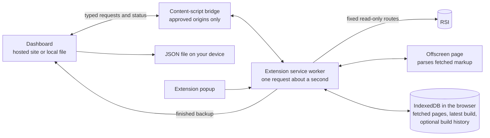

<p align="center">
  
</p>

<h1 align="center">CitizenData</h1>

<p align="center"><strong>Local backup tool for your Star Citizen account data.</strong></p>

<p align="center"><a href="https://citizendata.download">citizendata.download</a> · <a href="PRIVACY.md">Privacy</a> · <a href="SECURITY.md">Security</a> · <a href="RELEASING.md">Releasing</a></p>

CitizenData backs up your own RSI account to a JSON file on your device and lets you review it. It has two parts:

- A dashboard: a static page under [`docs/`](docs/) that opens a backup file, shows it, and exports parts of it. It runs from the hosted site or from a copy on your disk.
- A Chrome extension under [`extension/`](extension/) that reads your account from RSI while you are signed in and hands the result to the dashboard.

There is no server that receives your data. The dashboard and the extension talk only to each other and to RSI. Nothing is uploaded, and there is no analytics, telemetry, or tracking in either part.

## Status

Version `0.42.1` is the first release and is not yet published. The extension is not on the Chrome Web Store, so the "Get the CitizenData extension" link in the dashboard points at the store's front page for now. Until it is listed, load the extension unpacked (see [Development](#development)).

## What a backup holds

One build reads, in this order:

| Section | Source on RSI |
| --- | --- |
| Account identity | Your dossier and account settings |
| Balances and billing total | Store Credit, UEC, REC, and the total billed amount |
| Ledgers | Store Credit, UEC, and REC histories |
| Orders and subscriptions | Billing order history and subscription history |
| Hangar Log | Every entry, with RSI's wording kept as written |
| Current Hangar | Each pledge with its contained items, values, insurance, and image addresses |
| Buybacks | Each buy-back with its contained items |
| Referrals | Legacy recruits, current prospects, current recruits |
| Organizations | Your public memberships |
| Buy-back prices | One buy-back page for each item among the ordinary buy-backs: price, any discount as shown, contents, image addresses. Buy-backs with the same title and contents line are one item and share the read |
| CCU buy-back prices | RSI's store upgrade page: the price RSI asks now for each different CCU among the buy-backs, and the images of its two ships |

Member rosters of your organizations are a separate build you start from the Organizations panel, for the organizations you tick.

The backup is one JSON document checked against [`schema/account-export.schema.json`](schema/account-export.schema.json) and stamped with a SHA-256 of its content. The dashboard verifies both before it shows or exports a file, and saves every finished build to your device automatically.

### Things worth knowing

- A build paces itself at about one step a second, each step one or two requests, so a large account takes a while. Reading buy-back prices adds about eight minutes to a first build for every thousand different items among the ordinary buy-backs; RSI shows the same page for every buy-back of the same item, so further buy-backs of an item add nothing.
- Later builds are updates. The Hangar and the buy-back list are read again only when your Hangar Log has a new entry; everything else is read only as far as it changed, and a buy-back page is read only for an item no earlier build captured.
- A captured buy-back price is the price on the day its item's page was read, and it is not read again. CCU buy-back prices are read again on every build, one CCU at a time; **Skip** ends that stage and the build still finishes.
- A build can be paused, resumed, or cancelled. If one fails, what it collected opens as a partial backup and **Continue backup** picks up where it stopped.
- If Chrome stops the extension's background worker mid-build, a 30 second watchdog restarts it and the build goes on without repeating a request.

### Records RSI stops listing

RSI can remove a pledge or buy-back without writing a Hangar Log entry. When an update finds a record that the previous backup listed and RSI no longer lists:

- If no new Hangar Log entry names it, the record stays in the backup with the state `not-reconcilable`. The dashboard shows it first, in a red row labelled **POTENTIAL GHOST REMOVAL**.
- If a new log entry names it (a melt, a gift, a buy-back, or RSI's own removal notice), the log accounts for it and it leaves the list as usual.

The comparison runs only when an update read both lists again, which it does once your Hangar Log has a new entry, and only against a complete earlier backup whose Hangar Log lines up with the new one; otherwise the backup records that it did not run and why. Removed records are not counted in the Hangar and Buybacks totals.

**Keep your earlier backup files.** A removal can only be shown by comparing two backups.

## What stays in the browser

The extension keeps its working data in its own IndexedDB storage in your browser profile:

- The latest finished build of each account: one the extension made, or a complete account file you opened in the dashboard (see "Moving to another browser or a fresh installation" below). Updates and the removal comparison read it.
- While a build runs, each page it fetched, stored once with a checksum, so a build survives a restart. These are deleted when the dashboard confirms the file was saved.
- Earlier builds, while **Build history** is on in the extension popup. It is on unless you turn it off. While it is on, a build that differs from the one before keeps the earlier one, compressed, up to the number you choose (5 unless you change it). Each kept build can be saved as a file or deleted from the popup.
- Your organization rosters as one Orgs JSON, while **Build history** is on. The latest build always carries every roster you collected; with the history on, they are also kept ready as the Orgs JSON file the dashboard saves, replaced whenever a finished build carries different rosters. It is not counted against the number of builds to keep, and can be saved as a file or deleted from the popup.
- The images the dashboard downloads, while **Build history** is on. The dashboard downloads them and builds the Images ZIP as it does without the extension; the extension only stores what the dashboard hands it, one record per image, and makes no image request of its own. On a later visit the dashboard shows them from the extension without the Images ZIP, and the next image download reuses them. Loading an Images ZIP hands its images over in the same way. They are kept until you delete them with **Delete the kept images** in the popup.

**Clear all local extension data** in the popup removes all of it. The extension has Chrome's `unlimitedStorage` permission so that Chrome does not clear this storage when the disk runs low. The file saved to your device is the durable record.

**Moving to another browser or a fresh installation.** Open your latest account JSON with **Load JSON** in the dashboard. While **Build history** is on, the dashboard hands a complete account file to the extension by itself, and the extension keeps it as the account's latest build when it holds no build of that account, or an older one. The next build is then an update and not a first build, and a reload shows your account. The message that confirms the file says what the extension did. The extension checks the file's schema and SHA-256 again before it keeps it. It never replaces a newer build, takes in nothing while a build is in progress, and never takes in a Hangar Link file or a build that did not finish. A build it replaces goes to the build history like any other, and the rosters that build carried are kept in the new one. With Build history off, nothing is handed over.

An **Orgs JSON** you open after the account JSON is handed over in the same way. Its rosters go into the build the extension keeps, for each of the account's organizations whose roster there is missing or older; the next Organization Data run reads such a roster in full. An **Images ZIP** you open is unpacked by the dashboard, which hands its images to the extension one by one, as described under "What stays in the browser".

**Export recovery backup** and **Import recovery backup** in the popup carry the extension's other records, such as a run that did not finish. Load JSON also opens a recovery backup: it shows the newest finished build inside the file and hands that build to the extension in the same way.

The dashboard keeps the open backup in memory only. Reloading the page discards it; the file is untouched. While **Build history** is on, the dashboard asks the extension for your latest finished build when it loads and opens it in place of the example. With Build history off it opens the example, and the extension hands it nothing until you build.

## Reviewing and exporting

The dashboard shows identity, balances, subscriptions, the Hangar and Buybacks (100 to a page, with search and filters across the whole list), CCU history for upgraded pledges, referrals, organizations, and badges. The example account shown before you load a file is built into [`docs/scripts/demo-data.js`](docs/scripts/demo-data.js).

Exports are made only when you ask:

- Selected sections as JSON: account, Hangar, Buybacks, referrals, Hangar Log, billing, organization rosters, or a custom selection.
- A Hangar Link and Fleetview file (`hangarlink` version 1) holding the hangar, the buy-backs, or both. Buy-backs are written with their captured price.
- An offline image ZIP. The dashboard downloads the public images a backup links to, without credentials or referrer, four at a time, from `robertsspaceindustries.com` and `media.robertsspaceindustries.com` only. This works with the extension off or not installed; with the extension's **Build history** on, the same images are also kept in the extension.

### Opening a Hangar Link file

**Load JSON** also opens a Hangar Link file (`hangarlink` version 1). Such a file holds the hangar and the buy-backs and nothing else, so the dashboard opens it as an incomplete build:

- The hangar and the buy-backs are shown as the file states them. A record the file holds twice is shown once.
- The Hangar Log, billing, referrals, organizations, badges, and images are empty, and File Status reads "Incomplete build".
- A value the file cannot state is left empty: a pledge valued in UEC (Hangar Link writes a cost of 0 for those) and a buy-back with a cost of 0.
- **Build** then reads the whole account from RSI with the extension and replaces what is shown. It makes the same requests as any build: the file is never handed to the extension, and a Hangar Link file holds none of the histories an update can skip.
- No record is ever marked `not-reconcilable` because of a Hangar Link file. That comparison needs a complete earlier build with its Hangar Log.

## Safety model

- The extension's permissions are `alarms`, `cookies`, `offscreen`, `storage`, and `unlimitedStorage`, and its only host permission is `https://robertsspaceindustries.com/*`. `unlimitedStorage` gives no access to anything: it stops Chrome from clearing what the extension stores.
- RSI's own account requests need its session token. The extension reads that token from the browser for each request that needs it and sends it only to RSI. It is read transiently, never stored: it is not written to the backup, to messages, to logs, or to the extension's storage.
- The extension only reads. Its requests go to a fixed list of RSI routes held in the extension.
- The dashboard cannot name a URL, method, header, or body. It can only send a small set of typed requests (start a build, pause, resume, cancel, and the like), and the extension checks each plan itself.
- The extension answers the hosted dashboard at `https://citizendata.download` and nothing else, unless you approve a local copy. A copy opened from disk (`docs/index.html` in any folder) must be allowed once in the extension popup, and Chrome's "Allow access to file URLs" must be on for the extension. The approval can be removed in the popup.
- No remote code: both parts ship every script they run, under a content security policy that allows only their own files.

See [PRIVACY.md](PRIVACY.md) and [SECURITY.md](SECURITY.md).

## Architecture



The schemas in [`schema/`](schema/) are the source. `npm run sync:schemas` writes the copies the extension and the dashboard load.

## Repository layout

```text
.github/     the CI workflow
extension/   the Chrome extension, loadable as it is
docs/        the dashboard and the two policy pages, with no build step
schema/      the account and offline-package schemas
scripts/     verification, schema sync, the test runner, packaging, the DCO check
tests/       unit tests, a Node harness that runs the extension against a synthetic RSI, and browser checks
```

No private account export, captured RSI markup, session value, or private fixture belongs in this repository. Tests use a synthetic account.

## Development

Requirements: Node.js 22 or newer and Chrome.

```powershell
npm test
npm run verify
```

On Windows systems that block the `npm.ps1` shim, use `npm.cmd` from PowerShell; do not change the machine execution policy for this project.

`npm test` runs the unit tests, including whole builds of the shipped extension against a synthetic RSI. The browser checks run separately and headless:

| Command | What it checks |
| --- | --- |
| `npm run test:dashboard` | The dashboard in Chrome: layout at many widths, its workflows, and that it makes no remote request. `npm run test:dashboard -- --repairs-only` runs a shorter set. |
| `npm run test:extension` | The unpacked extension in Chrome against a synthetic RSI: approval of a local copy, a full build, an update, build history, pause and cancel, reload, watchdog restart, clearing data. `npm run test:extension -- --large` adds a very large account. |
| `npm run test:readability -- --out <dir>` | Contrast and text spacing. |
| `npm run test:hero-motion -- --out <dir>` | Hero animation. |
| `npm run test:performance`, `test:firefox`, `test:webkit` | Performance, Firefox, and a WebKit engine. A WebKit engine result does not establish Safari or iOS acceptance. Each prints its usage with `--help`. |

To load the extension:

1. Open `chrome://extensions` and turn on **Developer mode**.
2. Choose **Load unpacked** and select this repository's `extension` directory.
3. To use a dashboard opened from disk, turn on **Allow access to file URLs** in the extension's details, open [`docs/index.html`](docs/index.html), and allow it in the extension popup.

## Packaging

```powershell
npm run package:extension
```

This verifies the source, then writes a deterministic ZIP with `manifest.json` at its root and its SHA-256 under `dist/`. It does not stage Git, create a release, upload to the Chrome Web Store, publish the website, or change DNS. Those steps are the owner's and are listed in [RELEASING.md](RELEASING.md).

## Contributing

Code contributions are by invitation. Every commit needs a [DCO](https://developercertificate.org/) sign-off (`git commit --signoff`) and a signature GitHub verifies.

Run `npm test` and `npm run verify` before proposing a change, and say plainly if it touches a permission, the schema, privacy, storage, or the release surface.

Do not put private account exports, raw RSI responses, credentials, private screenshots, or private referral or member records in issues, pull requests, or fixtures.

## License

CitizenData's original software and documentation are licensed under the [MIT License](LICENSE).

Copyright (c) 2026 [LevyBytes](https://github.com/LevyBytes) ([original repository](https://github.com/LevyBytes/citizendata.download)).

The MIT terms require the copyright and permission notice to remain in copies or substantial portions of the software.

As a non-binding community courtesy, forks and derivative projects are requested to acknowledge CitizenData by LevyBytes and link to the original repository.

Third-party fonts, RSI/CIG visual material, community marks, and owner-supplied example artwork are not relicensed by the MIT License; see [THIRD_PARTY_NOTICES.md](THIRD_PARTY_NOTICES.md).

## Attribution

<p align="center"></p>

<p align="center"><strong>Built for citizens who want local backed up records of their own account history.</strong></p>

<p align="center">This independent community project is not affiliated with or endorsed by Cloud Imperium Games. Account data stays local in the device the browser runs on.</p>

<p align="center">Star Citizen®, Roberts Space Industries® and Cloud Imperium® are registered trademarks of Cloud Imperium Rights LLC. All related intellectual property and marks remain the property of their respective owners.</p>

Font and visual-asset notices are collected in [THIRD_PARTY_NOTICES.md](THIRD_PARTY_NOTICES.md).
